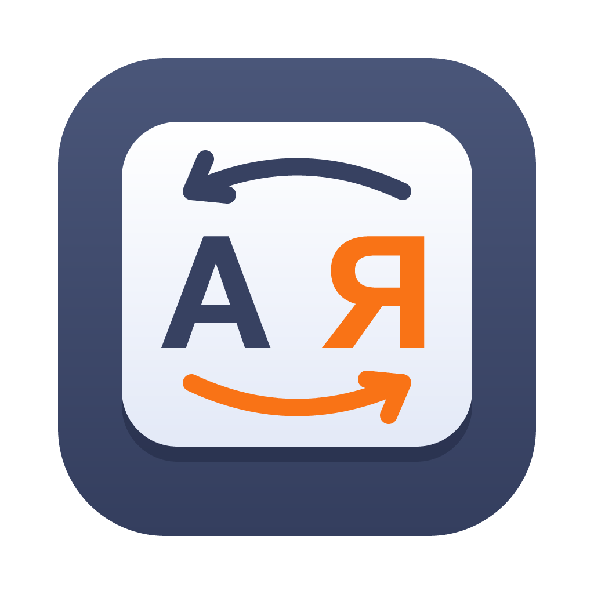

# WE KeySwitcher

<p align="center"></p>

WE KeySwitcher is a small native macOS menu bar app that fixes text typed in the wrong keyboard layout. Type `ghbdtn` with the English layout on and it becomes `привет` the moment you press space, and the layout switches to Russian. Press Option once and the last word (or the selected text) is converted by hand. It works between Russian and English, and between Russian and Slovak, and it never touches what you meant to type.

It is made for Macs with Apple M-series chips only (there is no Intel build), is written in Swift, works fully offline and keeps everything on your Mac. Made by [White Eagles & Co. s.r.o.](https://whiteeagles.sk/)

## What it does

- **Automatic switching after a word.** When you finish a word with space or punctuation, the app checks whether the keys you pressed make more sense in the other layout. If they do, the whole word is retyped in the right layout (punctuation included: `ghbdtn^` becomes `привет,`) and the system layout is switched. It only switches between Cyrillic and Latin; it never switches between two Latin layouts on its own.
- **Single Option converts by hand.** Press and release Option (without other keys in between) and the last word is converted to the other layout. Press it again right away and one more word before it is taken, then another, and so on. With text selected, Option converts the selection. After a click somewhere in a text, Option converts the word right before the caret.
- **Undo and learning.** Option right after an automatic switch puts the word back as typed. When you undo the switch of the same word three times, the word is remembered and is never switched again. The list of remembered words can be searched and edited from the menu.
- **Option+Shift inverts case** of the last word or of the selection: `пРИВЕТ` becomes `Привет`.
- **TWo capitals fixed.** `ПРивет` and `HEllo` become `Привет` and `Hello` at the end of the word.
- **Menus are left alone.** Option pressed while any menu is open (a Finder context menu, the menu bar, a pop-up) is ignored, so alternate menu items such as Finder's "Copy as Pathname" keep working.
- **Excluded apps and password fields.** Nothing happens in password fields (secure input) and in the apps you exclude in the menu (Visual Studio Code is excluded by default).
- **Menu bar indicator** of the current layout (RU, EN, SK, ...) with the settings menu, and an optional soft sound on every automatic switch.
- **Starts at login** (a standard login item that can be turned off in the menu).
- **PuntoSwitcher rules import.** On the first start the app imports the user rules of PuntoSwitcher, if it was installed, as remembered words.
- **Interface** in English, Russian and Slovak.

## How it decides

The decision is made for the whole word at once, from the keys that were pressed, not from the characters. The keys are rendered in the other layout with the real system layout tables (`UCKeyTranslate`), so every layout detail (Apple Russian punctuation, the Slovak number row, dead keys) is handled exactly as macOS does it.

Both readings of the word are then scored as language model probabilities:

1. **Word frequency dictionaries** for Russian, English and Slovak (about 1.1 million, 1.5 million and 540 thousand word forms). Russian and English mix everyday speech from movie subtitles with Wikipedia, which brings names and technical words such as `github` or `kubernetes`. Slovak is also recognised without diacritics, so `dakujem` typed in the English layout stays as it is.
2. **A character n-gram model** (order 4, Witten-Bell smoothing) for each language, used for words that are in no dictionary. It knows which letter combinations a language practically never has.
3. **Rules** that keep things as typed: words with digits, URLs, e-mail addresses, paths, domain names, camelCase, Latin abbreviations in capitals (`USA`, `HTML`), one-letter words, remembered words. Ambiguous short words need a much larger advantage before they are switched.

Leaving Cyrillic needs more evidence than entering it, because most of the text is expected to be Russian; the priors and margins live in `ClassifierConfig`.

## Accuracy

Measured by `keyswitcher-eval` on 29 132 cases: real words from the frequency lists (sampled by frequency, uniformly by rank, and rare words outside the dictionaries), a hand-made list of everyday and technical words, 1 000 words from the Webster dictionary and 500 English first names. Each word is typed in its own layout (must stay) and in the wrong layout (must be switched to exactly this word).

| | Cases | Errors |
|---|---:|---:|
| Correct words switched by mistake | 13 753 | 9 (0.07%) |
| Wrong-layout words not switched | 15 379 | 212 (1.38%) |
| Total | 29 132 | 221 (0.76%) |

Most of the remaining misses are rare words that are rare in both readings, and real collisions where both readings are frequent words: `руку` and `here`, `рук` and `her`, `щас` and `ofc`, `мы` and `vs` (the last one is switched to Russian). A word switched against your will is fixed with Option once, and learned after the third time. One-letter words (`я` typed as `z`, which is also a Slovak word) are never switched automatically by design.

## Requirements

- A Mac with an Apple M-series chip (M1 or newer) and macOS 15 or newer. Intel Macs are not supported.
- The Russian keyboard layout (Russian or Russian - PC) and at least one Latin layout (U.S., ABC, British, Slovak, Slovak - QWERTY, Czech and others) enabled in System Settings > Keyboard > Text Input.

## Install

1. Download `WE-KeySwitcher-<version>.zip` from [Releases](https://github.com/JaffarSk24/WE-KeySwitcher/releases), unzip it and move **WE KeySwitcher.app** to the Applications folder.
2. The app is not notarized by Apple, so the first start needs one confirmation: open it, then go to System Settings > Privacy & Security and press **Open Anyway** (or Control-click the app and choose Open).
3. Give it two permissions in System Settings > Privacy & Security: **Accessibility** and **Input Monitoring** (switch on WE KeySwitcher in both lists). The app picks the permissions up by itself within a couple of seconds; until then its menu bar title ends with `!` and the menu says what is missing.

## Usage

| Action | Result |
|---|---|
| Type a word in the wrong layout and press space | The word is retyped in the right layout, the layout switches |
| Option (press and release) | Converts the last word; again: one more word |
| Option right after an automatic switch | Undoes it (three undos of a word remember it) |
| Select text, Option | Converts the selection and switches the layout |
| Option+Shift | Inverts case of the last word or of the selection |

The menu bar menu has the switches for automatic switching, the sound and the two capitals fix, the list of remembered words, the excluded apps (add the app you were in, or choose any app), and Open at login.

## Data and settings

- Settings: the `sk.whiteeagles.keyswitcher` defaults domain.
- Remembered words and undo counters: `~/Library/Application Support/WE KeySwitcher/learned.json`.
- Debug log (off by default, it records the words you type): `defaults write sk.whiteeagles.keyswitcher debugLog -bool true`, written to `~/Library/Logs/WE KeySwitcher.log`.

The app makes no network connections and sends nothing anywhere.

## Building from source

Only the Command Line Tools are needed (Swift 6), Xcode is optional.

```bash
tools/make_cert.sh          # once: a local code signing certificate in the login keychain
tools/build_app.sh          # builds, signs, packs build/WE-KeySwitcher-<version>.zip and installs into /Applications
tools/test.sh               # unit tests (Swift Testing)
swift run -c release keyswitcher-eval .            # accuracy report on the word lists
swift run -c release keyswitcher-eval . --word=ghbdtn   # decision for one word
```

Signing every build with the same certificate matters: macOS ties the Accessibility and Input Monitoring permissions to the signature, so an ad hoc signed build asks for them again after each rebuild.

`keyswitcher-e2e` is an end-to-end check: it opens a TextEdit document and types real key events into it (switching words, undo, repeated Option, selection, case, menus, excluded apps), then compares the document text. It needs Accessibility for the terminal that runs it, the TextEdit automatic text corrections switched off, and nobody touching the keyboard while it runs.

The dictionaries in `Resources/data` are generated from the raw lists:

```bash
tools/fetch_data.sh                # downloads the frequency lists into data-raw/
python3 tools/prep_data.py         # writes Resources/data and the test word lists
```

## Project layout

- `Sources/KeySwitcherCore`: layout tables, dictionaries, n-gram models, the classifier, text helpers.
- `Sources/KeySwitcher`: the app: event tap, word history, Option gestures, selection through Accessibility with a clipboard fallback, menu, settings.
- `Sources/keyswitcher-eval`, `Sources/keyswitcher-e2e`: accuracy report and end-to-end check.
- `Tests`: unit tests and the test word lists.
- `tools`: data preparation, certificate, build and test scripts.

## License

The code is released under the [MIT License](LICENSE).

The dictionary and n-gram files in `Resources/data` and the word lists in `Tests/data` are derived from [FrequencyWords](https://github.com/hermitdave/FrequencyWords) by Hermit Dave (built from OpenSubtitles) and from [wikipedia-word-frequency](https://github.com/IlyaSemenov/wikipedia-word-frequency) by Ilya Semenov (built from Wikipedia). That content is licensed under [CC BY-SA 4.0](https://creativecommons.org/licenses/by-sa/4.0/), and so are the derived files; see [Resources/data/LICENSE.md](Resources/data/LICENSE.md). The Webster word list (Webster's Second International, whose copyright has lapsed) and the first names used in the tests come from the BSD word lists shipped with macOS in `/usr/share/dict`.
